# 花漾智秀 · Jisoo Blossom

以 JISOO《FLOWER》造型为参考、由 **jiangzengyuang-jisoo** 制作与适配的非官方 Codex 桌面宠物。

<p align="center">
  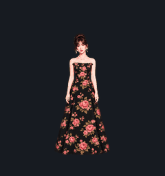
</p>

保留自然成人比例、盘发与刘海、珍珠项链和遮住双脚的及地花裙。为小尺寸显示简化了碎花，并优化眉眼与唇部轮廓。

## 动作展示

| 待机 | 挥手 | 跳跃 |
| :--: | :--: | :--: |
| 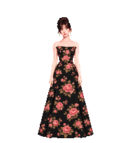 | 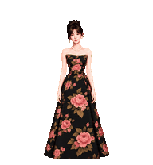 | 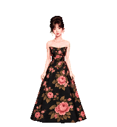 |
| 向左移动 | 向右移动 | 等待输入 |
| 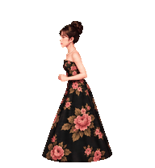 | 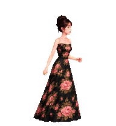 | 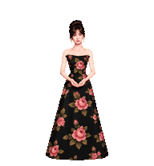 |
| 思考工作 | 检查结果 | 失落反应 |
| 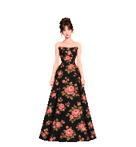 | 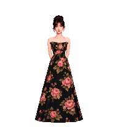 | 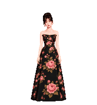 |

### 环视

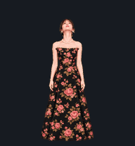

## 成品

- [下载 spritesheet.webp](pets/jisoo-blossom--jiangzengyuang-jisoo/spritesheet.webp)
- [运行时配置 pet.json](pets/jisoo-blossom--jiangzengyuang-jisoo/pet.json)
- [投稿与来源说明 submission.json](pets/jisoo-blossom--jiangzengyuang-jisoo/submission.json)
- [查看完整动作图](assets/contact-sheet.png)

采用 V2：图集 **1536 × 2288**，每格 **192 × 208**；九种基础动作、十六个环视方向，并附有投稿规范要求的默认站姿格。五官清晰度受原生尺寸限制，不宣称照片级还原。

## 安装

下载上面的 `pet.json` 和 `spritesheet.webp`，放入同一个目录：

```text
Windows: %USERPROFILE%\.codex\pets\jisoo-blossom--jiangzengyuang-jisoo\
macOS / Linux: ~/.codex/pets/jisoo-blossom--jiangzengyuang-jisoo/
```

如果已设置 `CODEX_HOME`，改为 `<CODEX_HOME>/pets/jisoo-blossom--jiangzengyuang-jisoo/`。安装目录只需要这两个运行时文件；`submission.json` 用于社区投稿。重新打开 Codex 后，在宠物选择入口选择“花漾智秀 · Jisoo Blossom”。

## 作者与来源

最终宠物资产由 **[jiangzengyuang-jisoo](https://github.com/jiangzengyuang-jisoo)** 策划与适配，使用 OpenAI Codex 内置图像生成功能独立生成、迭代编辑，再完成动画提取、统一缩放、透明边缘清理与图集拼接。


## 使用说明

**仅限非商业使用，禁止商用。** 使用或再分发时须保留 `jiangzengyuang-jisoo` 的制作与适配署名及来源说明。该说明不授予参考照片、人物肖像、名称、商标或其他第三方权利。

